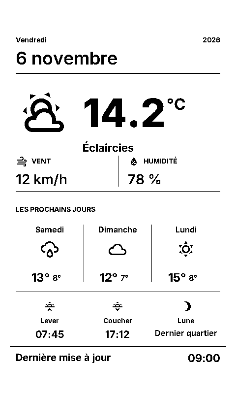

# ESPHome Weatherman

A French-language weather display for an **ESP32 and Waveshare 7.5-inch V2 monochrome e-paper panel**, connected to Home Assistant.

The portrait layout shows the date, current weather, temperature, humidity, wind, the next three days, sunrise, sunset and moon phase. Small text uses bold Inter fonts for readability. A separator sits above the larger last-update time.

## Preview

<p align="center">
  
</p>

Rendered example with sample readings, using the configured font sizes and bold weights. The original frame margins are included; the physical e-paper panel may look slightly different.

## Hardware and layout

- ESP32 development board, Arduino framework.
- Waveshare `7.50inV2`, rotated 270°, giving a logical resolution of **480 × 800**.
- Reserved frame margins: **20 px left/right, 62 px top, 57 px bottom**. The drawing code clips all information to that visible area.

| Connection | ESP32 GPIO |
| --- | --- |
| SPI clock | 13 |
| SPI MOSI | 14 |
| Display CS | 15 |
| Display DC | 27 |
| Display busy | 25, inverted |
| Display reset | 26 |

These pins match the working device this configuration was developed for. Check your board and wiring before use; GPIO15 is a strapping pin.

## ESPHome setup

1. Use ESPHome **2026.10.1**, the version used to validate and compile this configuration.
2. Copy `esphome/weatherman.yaml` to your ESPHome configuration directory.
3. Copy `esphome/secrets.example.yaml` to `secrets.yaml` beside it. Replace the sample Wi-Fi and OTA passwords and generate a new native API encryption key, for example with `openssl rand -base64 32`. The key field in the example is an intentionally invalid placeholder that must be replaced.
4. Download the icon font with `python tools/prepare_fonts.py`. Copy the resulting `esphome/fonts/materialdesignicons-webfont.ttf` beside the device YAML under `fonts/`.
5. Review the display pins, orientation and `Europe/Brussels` timezone. Set `ntp_server` to a reachable NTP server.
6. Validate and compile:

   ```sh
   python -m pip install -r requirements.txt
   esphome config esphome/weatherman.yaml
   esphome compile esphome/weatherman.yaml
   ```

7. Install the firmware using your normal ESPHome workflow and add the device to Home Assistant using its API encryption key.

Google Fonts are fetched by ESPHome while building. The device does not download fonts at runtime.

## Home Assistant setup

The example package assumes a weather entity named `weather.home` with **daily forecasts**, Celsius temperatures and wind speeds in km/h. Replace every `weather.home` reference in `home-assistant/weatherman.yaml` with your weather entity. Convert the wind template if your provider uses another unit.

Add Home Assistant's [Moon integration](https://www.home-assistant.io/integrations/moon/) and replace `sensor.moon_phase` in the package if your Moon entity has a different ID.

Place `home-assistant/weatherman.yaml` in your Home Assistant `packages` directory. Merge package loading into your existing configuration; do not duplicate an existing `homeassistant:` section:

```yaml
homeassistant:
  packages: !include_dir_named packages
```

Check the Home Assistant configuration and reload/restart as appropriate. If you already have Weatherman helpers or automations, merge the example instead of creating duplicate entities. Confirm the generated entity IDs match the IDs below.

| Entity | Purpose |
| --- | --- |
| `sensor.weatherman_main_temperature` | Current temperature |
| `sensor.weatherman_condition_code` | Numeric weather condition |
| `sensor.weatherman_humidity` | Relative humidity |
| `sensor.weatherman_wind_speed` | Wind in km/h |
| `sensor.weatherman_moon_code` | Numeric moon phase |
| `sensor.sunrise_timestamp` | Next sunrise, Unix seconds |
| `sensor.sunset_timestamp` | Next sunset, Unix seconds |
| `input_boolean.weatherman_auto_refresh` | Optional rising-edge refresh request |

The package fetches daily forecasts every 30 minutes and when Weatherman connects, then sends the next three future calendar days through `esphome.weatherman_forecast_update`. This is a call **from Home Assistant to the device**; the device does not need permission to perform Home Assistant actions.

A separate example automation presses `button.weatherman_refresh_display` at minutes 2 and 32, after the forecast feed. Adjust this schedule to suit your display. Trigger the forecast automation once and press **Refresh Display** for the first picture after setup.

## Refresh and missing-data behavior

- `update_interval: never`: drawing is explicitly requested through the refresh button or the rising edge of `input_boolean.weatherman_auto_refresh`.
- Receiving forecast data updates memory only; it does not write the e-paper panel.
- Forecasts older than six hours, missing values and invalid current readings use placeholders.
- Font bounds are measured before printing. Smaller fallback fonts are available for values that would otherwise exceed their allotted space.
- The refresh counter records requested display writes. It is not an optical check that the physical panel completed a refresh.

## Backups and credentials

Keep a copy of your working device YAML before changing firmware. This repository contains a portable configuration with `!secret` references. It intentionally excludes live credentials, private network addresses, device backups, generated firmware and local build data.

## Validation

The bold-font configuration was validated and compiled with ESPHome 2026.10.1 on the original board configuration. The portable public example is separately validated with example credentials. Other panels, wiring and frame cutouts require their own checks.

## Fonts and license

Project code is distributed under the [MIT license](LICENSE). Font files retain their upstream licenses; see [THIRD_PARTY_NOTICES.md](THIRD_PARTY_NOTICES.md). Fonts are downloaded separately rather than committed here.
